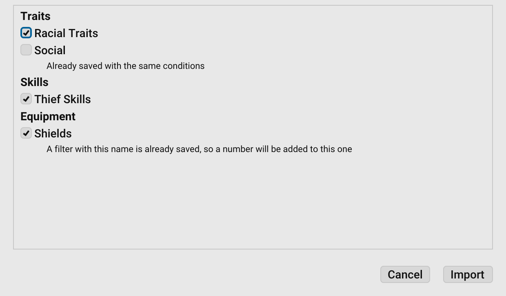

# User Guide Style Guide

## Purpose of this style guide

This style guide explains how to write and format pages for the **GURPS Character Sheet (GCS) User Guide**. It sets
standards for language, structure, tone, and formatting so all guide content is clear, consistent, and easy to navigate.

The User Guide is built into GCS and also published as the GCS wiki. Its source is the `userguide/content` folder in the
[gcs repository](https://github.com/richardwilkes/gcs). Make changes there with a pull request; the wiki is regenerated
from those files, so don’t edit the wiki directly.

If you’re adding or updating a page, follow these guidelines to make sure your contribution matches the rest of the
guide and provides the best possible experience for readers.

## Writing principles

When creating or updating a page, follow these guidelines:

1. **Write in plain language:** Follow the [Five Steps to Plain
   Language](https://centerforplainlanguage.org/learning-training/five-steps-plain-language/), focusing on:
   - Organizing information so it’s easy to follow.
   - Using common, everyday words.
   - Displaying information visually with lists, tables, and headings.
2. **Start with the “why”:** Begin each page with a short explanation of the feature and why a user might use it. Keep
   the explanation focused on **GCS**, not on teaching GURPS rules.
3. **Reference GURPS pages, don’t explain them:** Use short inline links like `[B10](B10)` or `[B242](B242)` to
   connect features to _GURPS Basic Set_ or other books. Don’t explain the rule itself, the citation is enough.
4. **Match the doc type:**
   - **Reference** (comprehensive details, often with tables)
   - **Tutorial** (step-by-step, with an example character)
   - **Orientation** (high-level overview of UI or workflows)
   - **Feature guide** (focused explanation of one feature, with context, tasks, and settings)
      Structure and level of detail should follow the type.
5. **Link and cross-reference:** Link to related pages for context. Link externally only when necessary.
6. **Use visuals when helpful:** Add screenshots or icons to illustrate steps or identify UI elements. Keep images up to
   date with the current GCS version.

## Formatting & conventions

Consistent formatting helps readers quickly understand and navigate the guide.

### Tone and style

Follow the [Microsoft Writing Style Guide](https://learn.microsoft.com/en-us/style-guide/top-10-tips-style-voice):

- Use **second person** (“you”).
- Use **active voice**: “Click **Save**,” not “The file should be saved.”
- Use contractions where natural (“you’ll” instead of “you will”).
- Keep sentences concise (ideally under 20 words).
- Avoid filler or redundant phrasing.

### Headings

- Use **sentence case** for all headings (capitalize only the first word and proper nouns).
  - Do: `## How to use the character sheet`
  - Don't: `## How To Use The Character Sheet`
- Structure pages logically with clear heading levels:
  - `#` Page title **only once** per page
  - `##` Major sections
  - `###` Subsections
  - `####` Optional sub-subsections

### UI elements

- Match menu names, button labels, and field names **exactly** as they appear in GCS.
  - Do: Select **File > Save**
  - Don't: Select Save in the file menu
- Use **bold** for UI elements (**OK**, **Save As…**).
- Use inline icons to reinforce what the user should click. Add the icon after the name.
- When showing menu paths, use a right angle bracket (>) with spaces: **File > Save As**.
- Follow [Microsoft’s UI interaction
  guidance](https://learn.microsoft.com/en-us/style-guide/procedures-instructions/describing-interactions-with-ui).

### Lists

- Use **numbered lists** for sequential steps.
- Use **bulleted lists** for unordered information.
- Begin each step with an **action verb**.
- Keep steps short, ideally one action per step.

### Links

- Link to another page by its name, with each space written as `%20` and no `.md` extension, such as
  `[Sheet Settings](Sheet%20Settings)`, so the link works both in GCS and on the wiki.
- Match the case of the file name exactly, such as `Character%20Points`, not `Character%20points`. The guide built into
  GCS is case-sensitive, so a link that differs only in case doesn’t work there.
- Run `go test ./userguide/` in the gcs repository before opening a pull request. It checks that every link, image, and
  anchor in the guide resolves.

### Tables

Tables are ideal when readers need to compare or scan structured information quickly.

- Always include a **header row** with clear, descriptive labels.
- Use **bold** for key terms in the first column.
- Keep descriptions short: 1–2 sentences max.
- Align text **left** (default in Markdown) for readability.
- Avoid embedding long procedures in a table; use lists under a table if needed.

### Adding images

- Save all screenshots and icons to the `images` folder, and refer to them with relative paths.
- For toolbar buttons without labels, add the **icon** after the name.
- Write icons in Markdown: ``
- Give each icon short alt text naming it, such as `add`.
- Add screenshots only if they clarify toolbars, menus, or layouts.
- Capture screenshots at 2x, as a high-resolution display such as a Mac's Retina display does.
- Write each screenshot as an HTML `` tag, not in Markdown, with alt text and a `width` of half its width in
  pixels, so it shows at the size it had on screen both in GCS and on the wiki. A screenshot 1240 pixels wide is
  written as:

  ```
  
  ```

  `go test ./userguide/` checks that every screenshot is written this way.

### Alerts

Use alerts consistently to highlight information:

> [!NOTE]
> Useful information the reader should know, even when skimming.

> [!TIP]
> Helpful advice for doing things better or more easily.

> [!IMPORTANT]
> Key information needed to achieve a goal.

> [!WARNING]
> Urgent info that needs immediate attention to avoid problems.

> [!CAUTION]
> Advises about risks or negative outcomes of certain actions.

---

[Return to Home](Home)
