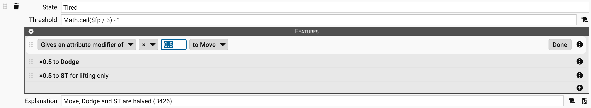
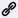

# Point Pools

The **Point Pools block** tracks your current and total **Hit Points (HP)** and **Fatigue Points (FP)** ([B16](B16)).
You can also create custom pools for other resources your character uses.

Each pool follows this format: `[current]` of `[total]` points `[STATE]`.

## Tracking HP and FP

To set your total points:

- Enter the total points in the second number group.

> **_Example:_** `[current]` of **_`[total]`_** points

GCS automatically updates your total [character point cost](Character%20Points) (the number in brackets on the left).

To track your current points:

- Enter the current points in the first number group.

> **_Example:_** **_`[current]`_** of `[total]` points

GCS shows the **state** of the pool on the right, such as _Reeling_ or _Rested_. It updates automatically as your
current points change, and the features of the pool's current threshold, such as halving your Move and Dodge, take
effect (see **Pool Thresholds** below). When that threshold has features, the state is shown in the **Warning** color
([Colors and Fonts](Colors%20and%20Fonts)), and its tooltip lists them after the threshold's explanation.

## Importing and exporting point pools

Point pools are part of your attributes. Follow the same steps as importing or exporting your
[Attributes](Attributes).

## Editing point pools

You can customize or create new pools. This works the same way as editing [Attributes](Attributes).

To edit or add a pool:

1. On the character sheet toolbar, select **Attributes** , or go to
   **Sheet > Attributes**.
2. On the editor, do one of the following:
   - **Edit** an existing pool or one of its thresholds. Select the pool's header first to expand it.
   - Select **Add Attribute**  on the toolbar, then set the new attribute's **Attribute
     Type** to **Pool**. A new pool starts with one threshold.
3. Fill in the fields in the form (see table below).
4. On the Attributes toolbar, select **Apply Changes**  to save.

A pool's maximum is editable on the sheet unless its **Attribute Type** is **Pool (Display Only for Maximum)**, in which
case only the current value can be changed. Pools can be hidden with the **Placement** setting, just like other
attributes. See [Attributes](Attributes) for details about each field.

> [!NOTE]
> You can also add point pools from other games by importing their attribute options. See [Attributes](Attributes) for
> details.

## Pool Thresholds

You can add thresholds to show how effects change as your pool decreases.

To add a point threshold:

- With the pool expanded, select **Add pool threshold**  on its row.

Each threshold includes the following fields:

| Field           | Description                                                                                                                                                                       |
|-----------------|-----------------------------------------------------------------------------------------------------------------------------------------------------------------------------------|
| **State**       | The effect name, such as _Reeling_ or _Rested_.                                                                                                                                   |
| **Threshold**   | The number (or script) that triggers the effect. This uses variables like `$hp` and expressions like `Math.ceil($hp / 3) - 1`. Thresholds must be ordered from lowest to highest. |
| **Features**    | What changes while the pool is at this threshold. See **Threshold features** below.                                                                                               |
| **Explanation** | Notes about what this threshold means and other effects. Supports [Markdown](Markdown%20Guide) and scripts.                                                                       |

### Threshold features

Each threshold has a **Features** section that works like the one in an item's Detail Editor (see
[Features](Features)). Its features take effect while the pool is at that threshold, and stop when the pool moves to
another. For example, the standard FP thresholds from _Tired_ down halve Move, Dodge, and ST for lifting, and the HP
thresholds from _Reeling_ down halve Move and Dodge.

A threshold isn't an item, so it offers fewer choices than an item's editor:

- **Feature types:** Attribute, skill, spell, trait level, DR, reaction, conditional, and weapon modifiers, plus grants
  of a trait, skill, or spell.
- **No levels or switch:** Features have no **per level** or **+ switchable** option, and can't select _this weapon_.
- **Attributes:** An attribute modifier can change any attribute other than a pool, plus **Move**, **Dodge**,
  **Parry**, and **Block**. It can't change a pool or the **Size Modifier**.

A feature the threshold can't use, such as a modifier of an attribute that has since become a pool, ends with _a pool
threshold ignores it_ and does nothing.

Features can be dragged between a threshold and the Features section of an open editor to copy them, as between two
editors. One the threshold can't use is refused.

#### Adding to or multiplying an attribute

On a threshold, **Gives an attribute modifier of** offers a choice of **±** or **×**: **±** adds the amount, and **×**
multiplies the attribute by it.

- Multipliers apply after every amount has been added, and stack with each other, including those of other pools. A
  whole-number value is rounded to the nearest whole number after each one, so halving Move 7 twice gives 4, then 2.
- A threshold changes only the attribute's current value, which skills, spells, Move, Dodge, and ST for striking,
  lifting, and throwing use. Point costs, and attributes calculated from this one, such as HP from ST, aren't
  affected. See [Attributes](Attributes) for how the sheet shows an adjusted attribute.
- A halved ST for lifting lowers everything figured from it, such as Basic Lift, damage based on lifting ST, the
  minimum ST penalty of crossbows and of ranged weapons that aren't muscle-powered, and the Jumping and Throwing
  [calculators](Calculator).
- Hover over a Move, Dodge, or Max Load value in the **Encumbrance, Move & Dodge** block, or a value in the
  **Lifting & Moving Things** block, to see what adjusts it, thresholds included.

#### Granting a trait, skill, or spell

A grant on a threshold puts its trait, skill, or spell on the sheet, in effect while the pool is at that threshold.
Otherwise, its rows stay on the sheet, dimmed and struck through. The chain icon
 beside a granted row names the threshold; select it to open the Attributes
editor, where the threshold is edited.

To add a grant, drag a trait, skill, or spell onto the threshold's Features section while its pool is expanded, or
select rows in a list and choose **Item > Add as Grant**. See [Features](Features) for the rest of a grant's options.

> [!NOTE]
> Older versions of GCS had **Halve Move**, **Halve Dodge**, and **Halve Strength** check boxes in place of features.
> GCS converts them to ×0.5 modifiers of Move, Dodge, and ST for lifting when it loads a file. As long as a
> threshold's features are just those halvings, GCS also saves the old settings, so older versions still apply them.
> Once you change the features, older versions see no effect from that threshold.

### Scripting

You can calculate thresholds using JavaScript. This is useful if you want the effects to scale with your character’s
HP, FP, or other values. See the [Scripting Guide](Scripting%20Guide).

## Managing point pools

- **Discard changes:** Select **Discard Changes** .
- **Delete a threshold or pool:** Select **Remove pool threshold** or **Remove attribute**
   beside it. A pool always keeps at least one threshold.
- **Reorder thresholds:** Drag a threshold using its grip .
- **Reset attributes (including point pools) to defaults:** Select **Reset**  to
  restore the sheet's attributes to the current [Default Attributes](Default%20Settings).

## Default point pools

You can change the default set of pools for new characters in [Default Attributes](Default%20Settings).

---

[Return to Home](Home)
