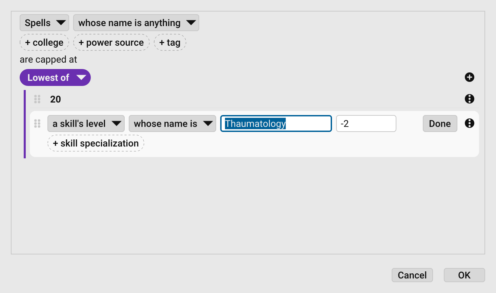

# Sheet Settings

You can adjust how your [Character Sheet](Character%20Sheet%20Overview) behaves using the **Sheet Settings** view.

> [!NOTE]
> **Sheet Settings** apply only to the character sheet you currently have open.
> To set defaults for _all new sheets you create_, use [Default Sheet Settings](Default%20Settings).

For other settings options, see [General Settings](General%20Settings).

To open Sheet Settings:

- Open a character sheet, then go to **Sheet > Sheet Settings**, or select **Sheet Settings**  on the character sheet toolbar.

Changes are applied immediately. You don’t need to save.

## Managing Settings

- **Reset settings to defaults:** Select **Reset** . This restores the current
  [Default Sheet Settings](Default%20Settings), including the default block layout, attributes, and body type.
- **Import or export settings:** On the Settings toolbar, select **Menu** , then
  choose:
  - **Import…:** Load saved settings into the sheet. The file's block layout, attributes, and body type are applied too.
  - **Export…:** Save the sheet's settings, block layout, attributes, and body type as a file.
  - Any `.sheet` settings files found in the `Settings` folder of your libraries are listed at the bottom of the menu,
    ready to import.

## Sheet Settings Options

The settings are grouped into sections.

### Damage

| Setting                          | Description                                                                                             |
|----------------------------------|---------------------------------------------------------------------------------------------------------|
| **Progression**                  | Choose a damage progression table. See **Damage Progression** below.                                    |
| **Show Lifting ST-based damage** | Displays damage based on Lifting ST on the Basic Damage block.                                          |
| **Show IQ-based damage**         | Displays IQ-based damage on the Basic Damage block ([PY120:7](PY120:7)).                                |

### Rules

| Setting                                                 | Description                                                                                                                                                                                                                                                                                     |
|---------------------------------------------------------|-------------------------------------------------------------------------------------------------------------------------------------------------------------------------------------------------------------------------------------------------------------------------------------------------|
| **Multiplicative Modifiers**                            | Applies the optional rule for Multiplicative Modifiers ([P102](P102)), which totals and applies enhancements, then totals and applies limitations.                                                                                                                                              |
| **Half-Stat Defaults**                                  | Applies the optional rule for Half-Stat Defaulting ([PY65:30](PY65:30)), which reduces the effect of very high attributes when defaulting on hard skills.                                                                                                                                       |
| **Modifying Dice + Adds**                               | Applies the optional rule ([B269](B269)) that converts damage adds to dice. Example: `2d+5` becomes `3d+1`.                                                                                                                                                                                     |
| **Exclude unspent points from total**                   | If checked, your unspent [Character points](Character%20Points) aren't included in the total.                                                                                                                                                                                                   |
| **Disable traits whose prerequisites are unsatisfied**  | Treats a trait whose [prerequisites](Prerequisites) aren't met, or whose level exceeds its maximum, as disabled until they are: it contributes no points, features, or attacks. Traits whose prerequisites contradict each other are left enabled and tagged **Contradictory prerequisite(s)**. |

### Columns

| Setting                                                      | Description                                                                                                                                                                             |
|--------------------------------------------------------------|-----------------------------------------------------------------------------------------------------------------------------------------------------------------------------------------|
| **Show library source**                                      | Displays the library source column . See _Master Library Syncing_ in [Character Sheet Overview](Character%20Sheet%20Overview) for more details.   |
| **Show page reference**                                      | Displays the page reference column . See [Page References](Page%20References) for more details.                                    |
| **Show tech level (TL)**                                     | Displays the Tech Level ([B22](B22)) column in the equipment lists.                                                                                                                     |
| **Show legality class (LC)**                                 | Displays the Legality Class ([B267](B267)) column in the equipment lists.                                                                                                               |
| **Hide unused columns in the melee & ranged attack tables**  | Leaves out any attack table column whose cells are all empty, such as the accuracy and range columns for powers that don't use them.                                                    |

### Display

| Setting                                               | Description                                                                                                                                                                                         |
|-------------------------------------------------------|-----------------------------------------------------------------------------------------------------------------------------------------------------------------------------------------------------|
| **Show trait modifier cost adjustments**              | Shows each modifier's cost in a trait's notes.                                                                                                                                                      |
| **Show equipment modifier cost & weight adjustments** | Shows cost and weight changes in equipment notes. For example: `[x2 to original cost; x2 to base weight]`.                                                                                          |
| **Show spell ritual, cost & time adjustments**        | Displays casting details for spells ([B237](B237)).                                                                                                                                                 |
| **Show all attacks**                                  | Displays every attack on your sheet, even from items that aren't carried or equipped. Attacks from unequipped or uncarried items are marked `(not carried)` or `(not equipped)`, as appropriate.    |
| **Hide conditional modifiers whose total is zero**    | Leaves out conditional modifiers whose bonuses cancel out to +0, such as an item that negates a disadvantage's penalty. Leave it off to keep such entries visible for troubleshooting.              |
| **Show the title instead of the name in the footer**  | Displays the character’s title from the Identity block instead of their name in the page footer.                                                                                                    |
| **Where to display**                                  | Controls where **User Description**, **Modifiers**, **Notes**, and **Skill Level Adjustments** are shown: **Not Shown**, **Inline**, **Tooltip**, or **Inline & Tooltip**.                          |

### Units of Measurement

| Setting    | Description                                                                                                                                                                        |
|------------|------------------------------------------------------------------------------------------------------------------------------------------------------------------------------------|
| **Length** | The units lengths are shown in: Feet & Inches, in, ft, yd, mi, cm, m, or km.                                                                                                       |
| **Weight** | The units weights are shown in: lb, #, oz, tn, t, kg, or g.                                                                                                                        |

Values are always stored in inches and pounds. Metric units use the simplified GURPS conversions: 2.5 cm
per inch and 2 lb per kilogram.

### Decimal Places

Choose how many decimal places the sheet shows for the **Height** and **Body Weight** in the Description block, for
**Equipment Weight**, and for **Equipment Value**: **As Needed** (every decimal place the value has) or 0 to 4 places.
Check **Pad with zeros** to show trailing zeros so that columns line up.

Only the display changes. Values are still stored and calculated at full precision, hovering over a rounded value
shows the exact figure, and clicking into the height or weight field shows the exact value for editing. Templates and
loot sheets follow the equipment settings in the [Default Sheet Settings](Default%20Settings).

### Trading

These settings are used when a character buys or sells [Equipment](Equipment).

| Setting          | Description                                                                                                                                                                                                                             |
|------------------|-----------------------------------------------------------------------------------------------------------------------------------------------------------------------------------------------------------------------------------------|
| **Buy Percent**  | The percentage of an item's full price that buying it costs, unless another is chosen when buying. The default is 100%.                                                                                                                 |
| **Sell Percent** | The percentage of an item's full price that selling it brings in, unless another is chosen when selling. The default is 50%.                                                                                                            |
| **Sell Money**   | The coins that sales pay out in and that change is returned in. Drag equipment tagged `Money` (such as the coins in the Master Library) from any equipment list into the box to add it. Select **Remove** beside a coin to take it out. |

### Skill Level Caps

Skill level caps hold [skills](Skills) and [spells](Spells) to a limit, such as the highest skill level a campaign
allows or a house rule that no spell may exceed Thaumatology -2. The list shows each cap as a sentence, such as _Spells
are capped at the lowest of 20 and skill Thaumatology -2_. The order of the caps doesn't matter.

- **Add a cap:** Select **Add a skill level cap…**  below the list. Build the cap in the
  **New Skill Level Cap** dialog (see below), then select **OK**.
- **Edit a cap:** Select its sentence to open it in the **Edit Skill Level Cap** dialog. **Cancel** leaves the cap as it
  was.
- **Remove a cap:** Select **Remove cap**  beside it, then confirm. Removing a
  cap can't be undone.

Caps set in [Default Sheet Settings](Default%20Settings) are copied into each new character sheet, which then keeps its
own.

#### Building a cap

The top of the dialog says which skills and spells the cap applies to:

- Choose **Skills**, **Spells**, or **Skills and spells** in the first dropdown. Techniques count as skills and Ritual
  Magic spells as spells. Containers are never capped.
- Leave the name comparison at _whose name is anything_ to select them all, or choose another, such as _whose name is_
  or _whose name contains_, and enter the name. See [Operators](Operators).
- Add optional criteria as chips to narrow the selection: **+ specialization** (skills), **+ college** and **+ power
  source** (spells), and **+ tag**. Separate several tags or colleges with commas to match any one of them. Select the
  **x** on a chip to remove it.

Below **are capped at** are the values the cap holds them to. Select **No cap values. Click here to add one.** or **Add
to this group** , then choose one of these under **Cap Value**:

| Cap Value           | Caps at                                                                                                                                           |
|---------------------|---------------------------------------------------------------------------------------------------------------------------------------------------|
| **Fixed Level**     | A level you enter. It starts at 12.                                                                                                               |
| **Skill Level**     | The level of a skill on the sheet, picked by name, plus an adjustment such as `-2`. Add **+ skill specialization** to pick by specialization too. |
| **Spell Level**     | The level of a spell on the sheet, picked by name, plus an adjustment.                                                                            |
| **Trait Level**     | The level of a trait on the sheet, picked by name, plus an adjustment, such as `+10` for _Magery +10_.                                            |
| **Attribute Value** | The current value of one of the sheet's attributes, **Size Modifier**, or **Dodge**, plus an adjustment. It starts at DX.                         |

When a name matches several enabled skills, spells, or traits, the highest level among them is used.

- **Editing a value:** Select its sentence to open it, then select **Done** (or press `Return` or `Escape`) to close
  it. Its first dropdown switches it to **a fixed level**, **a skill's level**, **a spell's level**, **a trait's
  level**, or **an attribute's value**. Switching among a skill, spell, and trait keeps the name and adjustment.
- **Groups:** Values hang from a colored line beneath a group pill. Select the pill to choose how the group combines
  them:
  - **Lowest of:** the cap is the lowest of the values in the group.
  - **Highest of:** the cap is the highest of them.
- **Nesting:** Choose **Lowest of Group** or **Highest of Group** under **Structure** to add a group inside another,
  as in _the lowest of 20 and the highest of skill Thaumatology -2 and trait Magery +10_. On a cap with no values yet,
  it sets the type of the top group instead.
- **More actions:** Select **More actions**  beside a value or group for
  **Duplicate**, **Move Up**, **Move Down**, **Wrap in Group**, **Ungroup**, and **Delete**. A group's menu also adds
  values and groups to it.
- **Reordering:** Drag a value or group by its grip  to move it.

**OK** stays unavailable until the cap has at least one value. Every change in the dialog can be undone with the
**Undo** [menu key](Menu%20Keys), which is `Ctrl+Z` (`Cmd+Z` on macOS) unless you've changed it.

#### How caps apply

- A cap only lowers a level, never raises it. It applies to the level with all its bonuses. For a skill with an
  **Encumbrance Penalty**, it applies before the penalty, which still lowers the capped level.
- When several caps select the same skill or spell, the lowest of them applies.
- Anything the sheet lacks counts as 0. A value whose name matches nothing on the sheet, or only items with no level,
  is its adjustment alone, and an attribute the sheet doesn't have counts as 0. So _Spells are capped at skill
  Thaumatology -2_ holds every spell to -2 on a sheet without Thaumatology, rather than leaving them uncapped. Only an
  empty group caps nothing.
- A skill or spell is never held to a value resting on its own level: _Skills are capped at skill Thaumatology -2_
  leaves Thaumatology itself as it is.

The capped level is the one the rest of GCS sees:

- The **SL** and **RSL** columns show it. Their tooltip adds a line naming the cap and what it took off, such as
  `Level cap of 14 (Thaumatology -2) [-3]`, which also appears wherever **Skill Level Adjustments** are shown (see
  **Where to display** under **Display**).
- The **Level** in the Skill Editor and Spell Editor shows it, updated as you edit.
- Skills that default from a capped skill, and prerequisites that check a skill's level, use it.
- **Increase Skill Level** doesn't raise a skill or spell that is held at its cap.

#### Importing and exporting caps

The **Skill Level Caps Menu**  below the list holds:

- **Import…:** Add the caps in a `.caps` file after those already listed, skipping any that match one already there.
- **Export…:** Save the listed caps as a `.caps` file. Unavailable while the list is empty.
- Any `.caps` files found in the `Settings` folder of your libraries, listed at the bottom of the menu, ready to import.

The **Import…** and **Export…** on the toolbar's **Menu** include the caps with the rest of the settings. Importing a
`.sheet` file that way replaces the caps instead of adding to them.

### Page

Adjust paper size, orientation, and margins for printing, PDF and image export, and the pages view of the sheet (see
[Character Sheet Overview](Character%20Sheet%20Overview)).

| Setting         | Description                                                                                                              |
|-----------------|--------------------------------------------------------------------------------------------------------------------------|
| **Paper Size**  | A standard paper size name (see the table below) or a custom size, such as `8.5in x 11in` or `210mm x 297mm`.            |
| **Orientation** | **Portrait** or **Landscape**.                                                                                           |
| **Margins**     | The **Top**, **Bottom**, **Left**, and **Right** page margins, in `in`, `cm`, or `mm`. A value without units is inches.  |

| Page Name | Size                           |
|-----------|--------------------------------|
| `letter`  | 8.5 x 11 in (216 x 279 mm)     |
| `legal`   | 8.5 x 14 in (216 x 356 mm)     |
| `tabloid` | 11 x 17 in (279 x 432 mm)      |
| `a0`      | 841 x 1189 mm (33.1 x 46.8 in) |
| `a1`      | 594 x 841 mm (23.4 x 33.1 in)  |
| `a2`      | 420 x 594 mm (16.5 x 23.4 in)  |
| `a3`      | 297 x 420 mm (11.7 x 16.5 in)  |
| `a4`      | 210 x 297 mm (8.3 x 11.7 in)   |
| `a5`      | 148 x 210 mm (5.8 x 8.3 in)    |
| `a6`      | 105 x 148 mm (4.1 x 5.8 in)    |

## Damage Progression

Choose how damage scales with Strength.

> [!TIP]
> If you’re not sure which option to use, stick with **Basic Set**. The other tables are optional house-rules.

| Damage Progression Option                                       | Description                                                                                                                                                                                                                   |
|-----------------------------------------------------------------|-------------------------------------------------------------------------------------------------------------------------------------------------------------------------------------------------------------------------------|
| **Basic Set**                                                   | Standard GURPS damage table from [B16](B16).                                                                                                                                                                                  |
| **Knowing Your Own Strength**                                   | An alternative rule from [PY83:16](PY83:16) that smooths out high-ST damage scaling, making progression more gradual. Basic Lift uses the table from the article, and ST and HP are exempt from the SM cost reduction.        |
| **Knowing Your Own Strength (without Basic Lift adjustment)**   | The same damage progression, but Basic Lift is calculated the standard way ([B15](B15)).                                                                                                                                      |
| **No School Grognard Damage**                                   | A house-rule that reduces swing damage to narrow the gap with thrust. Intended for Dungeon Fantasy play. See [No School Grognard](https://noschoolgrognard.blogspot.com/2013/04/adjusting-swing-damage-in-dungeon.html).      |
| **Thrust = Swing-2**                                            | Sets thrust damage equal to swing-2 across the table. A lightweight alternative to Knowing Your Own Strength that doesn’t change Basic Lift, ST cost, or other traits.                                                        |
| **Swing = Thrust+2**                                            | A house-rule that makes swing damage equal to thrust+2. See [Gaming Ballistic](https://gamingballistic.com/2020/12/04/df-eastmarch-boss-fight-and-house-rules/).                                                              |
| **T Bone's New Damage for ST (option 1)**                       | A linear ST-based damage progression from [T Bone’s Games Diner](https://www.gamesdiner.com/rules-nugget-gurps-new-damage-for-st/).                                                                                           |
| **T Bone's New Damage for ST (option 1, cleaned)**              | Simplified version of option 1.                                                                                                                                                                                               |
| **T Bone's New Damage for ST (option 2)**                       | Variant of the linear progression.                                                                                                                                                                                            |
| **T Bone's New Damage for ST (option 2, cleaned)**              | Simplified version of option 2.                                                                                                                                                                                               |
| **Phoenix Flame D3**                                            | A house-rule that uses d3s instead of d6s for damage.                                                                                                                                                                         |

## Sheet layout

The arrangement of the blocks on the sheet is no longer a setting. It is edited directly on the sheet with **Edit
Layout**  on the character sheet toolbar. See _Sheet layout_ in
[Character Sheet Overview](Character%20Sheet%20Overview).

## Default Sheet Settings

You can change the default sheet settings for new characters in [Default Sheet Settings](Default%20Settings).

---

[Return to Home](Home)
