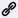

# Traits

The **Traits list** on your [character sheet](Character%20Sheet%20Overview) includes all your **advantages**
([B32](B32)), **disadvantages** ([B119](B119)), and **quirks** ([B162](B162)).

## Master Library

GCS includes hundreds of official traits in the **Master Library** that are taken from GURPS books and other
supplements. See [Library Explorer](Library%20Explorer) for more details.

You can also create your own custom traits.

## Traits list

The traits list on your character sheet includes the following columns. Select a column heading to sort ascending
 or descending .

| Column                                                | Description                                                                                                                                                                                                                 |
|-------------------------------------------------------|-----------------------------------------------------------------------------------------------------------------------------------------------------------------------------------------------------------------------------|
|      | Appears only when a trait has switchable [features](Features). Select the cell to turn the trait's switch on or off.                                                                                                        |
| **Trait**                                             | The trait name and any notes, self-control rolls, or modifiers. Select the chevron  to show or hide the notes for this trait.                                              |
| **Pts**                                               | Total [character point](Character%20Points) cost for the trait.                                                                                                                                                             |
|  | Page reference for the trait. See [Page References](Page%20References) for more details.                                                                                                                                    |
|                 | Tracks whether the trait matches the library it came from. See _Master Library Syncing_ in [Character Sheet Overview](Character%20Sheet%20Overview).                                                                        |

A disabled trait is dimmed and struck through. A trait whose [prerequisites](Prerequisites) aren't met is tagged
**Unsatisfied prerequisite(s)**, and a trait put on the sheet by another item's grant is marked with a chain icon
. Container traits show their type after their name, such as _Ancestry_ or
_Alternate_.

> [!TIP]
> From the character sheet toolbar, you can quickly expand or collapse traits and notes:
>
> - **Opens/closes all hierarchical rows**  shows or hides all traits
>   within containers.
> - **Opens/closes all embedded notes**  shows or hides all
>   embedded notes.

## Adding traits

To add an advantage or disadvantage:

1. Open a traits list from the **Master Library**.
2. Choose the trait you want.
3. Add the trait in one of two ways:
   - Drag it from the list to your sheet, or
   - Right-click it and select **Copy to Character Sheet**.

You can also [create a new custom trait](Custom%20Content):

- On your character sheet, go to **Insert > Trait > New Trait**, or right-click the Traits list and select **New
  Trait**.

When you add a trait:

- GCS highlights the block where it can be dropped. No matter where you drag it, it goes to the right location.
- The **Points block** updates automatically:
  - Advantages subtract from unspent points.
  - Disadvantages (negative points) add to unspent points.
- Some traits include [substitution **placeholders**](Substitutions) (for example, `@Who@`). You can set these when
  first adding the trait, or later with **Set Substitutions**  in
  the editor's toolbar.
- Some traits have **modifiers**. When you first add a trait that has modifiers, GCS prompts you to select them. You
  can select one, several, or none, and a modifier choice marked **Pick 1** must be made, by you or at random with
  **Auto Pick**. If you skip this step, you can add or edit modifiers later in the **Trait Editor**. See [Trait
  Modifiers](Trait%20Modifiers) for more details.

## Managing traits

You can change traits on your sheet in a few ways.

### Increasing or decreasing a trait’s level

To increase a trait’s level:

- Right-click the trait on your character sheet and select **Increment**, or
- Go to **Item > Adjust > Increment** (`Ctrl+=` / `Cmd+=`).

To decrease a trait’s level:

- Right-click the trait and select **Decrement**, or
- Go to **Item > Adjust > Decrement** (`Ctrl+-` / `Cmd+-`).

GCS automatically recalculates the total point cost when you increase or decrease a level. A trait with a **Maximum
Level** can't be raised past it, and is tagged on the sheet if a bonus pushes it over.

### Enabling and disabling traits

A disabled trait stays on the sheet but contributes no points, features, or attacks. Use this for abilities the
character has lost or isn't using.

- Right-click the trait and select **Toggle State**, or go to **Item > Toggle State** (`Ctrl+'` / `Cmd+'`).
- Or clear the **Enabled** check box in the trait's editor.

### Organizing traits with containers

You can group traits (advantages, disadvantages, etc.) into [Containers](Containers) for easier management.

For example:

- Put **Combat Reflexes** and **High Pain Threshold** into a “Combat Traits” container.
- Use **Alternative Abilities** or **Meta-Trait** container types to apply special grouping rules.
- Use an **Ancestry** container for a racial template, so the character's random name, height, and weight follow it.

To file every top-level trait into containers automatically, go to **Sheet > Organize Traits**. GCS sorts them into
**Advantages**, **Perks**, **Disadvantages**, **Quirks**, **Features**, and **Languages** containers by their tags or,
failing that, their point costs, creating any containers that don't exist yet and removing any left empty.

### Moving traits

Drag traits to rearrange them, or select them and use **Item > Move > Move Up**, **Move Down**, **Move Into
Container**, and **Move Out of Container** (`Ctrl+Shift+Arrow` / `Cmd+Shift+Arrow`).

### Deleting a trait

To delete a trait:

- Right-click it and select **Delete**, or
- Go to **Edit > Delete**.

## Editing traits

You can edit a trait in a few ways:

- Double-click it to open the **Trait Editor**.
- Right-click it and select **Open Detail Editor**.
- Select a trait and go to **Item > Open Detail Editor** (`Ctrl+I` / `Cmd+I`).

Save your changes when you're done from the **Trait Editor toolbar** (see below). A trait put on the sheet by a grant
opens read-only.

## Trait Editor fields

The Trait Editor includes the following fields:

| Trait Editor Field          | Description                                                                                                                                                                                                                                                      |
|-----------------------------|------------------------------------------------------------------------------------------------------------------------------------------------------------------------------------------------------------------------------------------------------------------|
| **Name**                    | The trait's name.                                                                                                                                                                                                                                                |
| **Notes**                   | Notes about what the trait does. These appear below the trait in the list. Select the Scripting Guide  for instructions on how to include JavaScript. Supports [Markdown](Markdown%20Guide).              |
| **VTT Notes**               | Notes for use in your Virtual Tabletop system. See your VTT’s documentation.                                                                                                                                                                                     |
| **User Description**        | Additional notes for your reference. These appear as a tooltip when you hover, and only exist on character sheets and on the trait a [grant](Features) holds, which passes them to the sheet.                                                                    |
| **Tags**                    | Comma-separated [Tags](Tags) to help organize traits.                                                                                                                                                                                                            |
| **Preconfigured**           | Only in templates and libraries. If checked, the trait's modifier choices and substitutions are already settled, so GCS doesn't ask about them when the trait is added to a sheet. See [Substitutions](Substitutions).                                           |
| **Enabled**                 | If checked, the trait applies to your sheet.                                                                                                                                                                                                                     |
| **Switched On**             | Whether the trait's switchable [features](Features) are on. Only matters when a feature is marked switchable.                                                                                                                                                    |
| **Point Cost**              | Read-only. Total cost of the trait, with levels and modifiers applied. Shows a range while a modifier choice is still open.                                                                                                                                      |
| **Round Down**              | If checked, rounds the total point cost down.                                                                                                                                                                                                                    |
| **Base Cost**               | The cost before modifiers or levels.                                                                                                                                                                                                                             |
| **Levels**                  | If checked, the trait uses levels. Enter the current level in the field beside it.                                                                                                                                                                               |
| **Cost Per Level**          | Point cost per level.                                                                                                                                                                                                                                            |
| **Maximum Level**           | The highest level the trait may have. May be a number or a script (for example, one that varies with SM). Leave blank for no maximum.                                                                                                                            |
| **Adjusted Maximum Level**  | Read-only. The maximum after any [features](Features) that adjust it.                                                                                                                                                                                            |
| **Self-Control**            | The self-control roll to resist ([B120](B120)). The CR rating will show in parentheses on your character sheet.                                                                                                                                                  |
| **Self-Control Adjustment** | Adjustments tied to self-control rolls, such as reaction or fright check penalties ([B121](B121)).                                                                                                                                                               |
| **Frequency of Appearance** | Sets how often the trait’s subject (such as an Ally, Contact, or Enemy) appears in play ([B36](B36)).                                                                                                                                                            |
| **Page Reference**          | Page number for the trait. Select the bookmark  beside the label to open it. See [Page References](Page%20References) for details.                                                                          |
| **Page Highlight**          | Text to highlight in the PDF. Leave blank unless the default highlights fail.                                                                                                                                                                                    |
| **Nameables**               | Defines the `@code@` placeholders the trait uses, with the choices offered for each. See [Substitutions](Substitutions).                                                                                                                                         |
| **Prerequisites**           | Any requirements for this trait. See [Prerequisites](Prerequisites).                                                                                                                                                                                             |
| **Features**                | Lists attribute, condition, skill, spell, reaction, or attack changes applied by the trait, and anything it grants. See [Features](Features).                                                                                                                    |
| **Trait Modifier**          | Modifiers that apply to the trait. You can enable a modifier to apply it to your sheet. See [Trait Modifiers](Trait%20Modifiers).                                                                                                                                |
| **Melee Attack Usage**      | Lists melee attack statistics ([B268](B268)), including skill defaults. See [Melee and Ranged Weapons](Melee%20and%20Ranged%20Weapons).                                                                                                                          |
| **Ranged Attack Usage**     | Lists ranged attack statistics ([B268](B268)), including skill defaults. See [Melee and Ranged Weapons](Melee%20and%20Ranged%20Weapons).                                                                                                                         |
| **Study**                   | Only on character sheets. Allows you to track study time for this trait. See [Study time](Study%20time).                                                                                                                                                         |

Container traits have fewer fields, plus a **Container Type**. See [Containers](Containers).

## Trait Editor toolbar

The toolbar above the Trait Editor gives you quick access to common actions:

| Button                                                  | Name                    | Description                                                                                                                                                                                                       |
|:--------------------------------------------------------|-------------------------|-------------------------------------------------------------------------------------------------------------------------------------------------------------------------------------------------------------------|
|                       | **Help**                | Opens this page from the User Guide.                                                                                                                                                                              |
| 100%                                                    | **Scale**               | Adjusts the display size of the Trait Editor.                                                                                                                                                                     |
|      | **Apply Changes**       | Saves and closes the Trait Editor (`Ctrl+Return` / `Cmd+Return`).                                                                                                                                                 |
|  | **Discard Changes**     | Exits without saving changes (`Escape`).                                                                                                                                                                          |
|     | **Set Substitutions**   | Lets you enter values for traits with placeholders in their text. For example, for _Enemy_ you can replace `@Who@` with the foe's name.                                                                           |
|                   | **ID & Library Source** | Shows the trait's ID and, if it came from a library, its source. Select an entry to copy it. Offers **Sync with Source** and **Clear Source**, which take effect when you apply your changes.                     |

> [!NOTE]
> When you first add a trait with substitutions, a prompt appears for you to fill them in. If you skip it, you can set
> them later with **Set Substitutions**.

## Customizing the Traits list

You can move, resize, or hide the Traits block by editing the **sheet layout**. See [Character Sheet
Overview](Character%20Sheet%20Overview).

---

[Return to Home](Home)
